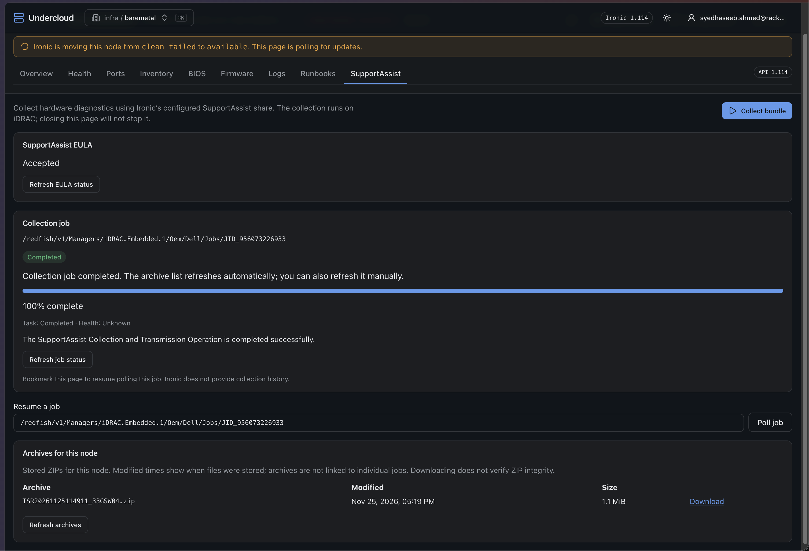

# Diagnostics Archives

Diagnostic files uploaded by BMCs are stored on the `diagnostics` volume of the
`diagnostics` deployment in the `understack-diagnostics` namespace. Each kind
has its own directory, and each node's files live in
`/data/<kind>/<node_uuid>/`. SupportAssist collections are ZIP files in
`/data/supportassist/<node_uuid>/`.

NodeDash lists and downloads a node's SupportAssist archives on its
**SupportAssist** tab. It cannot delete them, so clear old files with the steps
below. Files are never deleted automatically, and uploads fail when the volume
is full.



## Setup

```bash
alias diag='kubectl -n understack-diagnostics exec deploy/diagnostics --'
```

## Check space

```bash
diag df -h /data
diag du -h -d 2 /data
```

## List files

```bash
diag find /data -path /data/.tmp -prune -o -type f -exec ls -l {} \;
```

## Copy a file out

```bash
kubectl -n understack-diagnostics get pods -l app=diagnostics
kubectl -n understack-diagnostics cp <pod>:/data/supportassist/<node_uuid>/<file>.zip ./<file>.zip
```

## Delete files

Delete one file, using a path from the list:

```bash
diag rm /data/supportassist/<node_uuid>/<file>.zip
```

Delete all SupportAssist archives:

```bash
diag find /data/supportassist -name '*.zip' -delete
```

Re-run the list to confirm, then click **Refresh archives** in NodeDash.

!!! warning
    Deletion is permanent. Delete only files; keep the kind directories, the
    node UUID directories and `/data/.tmp`.
